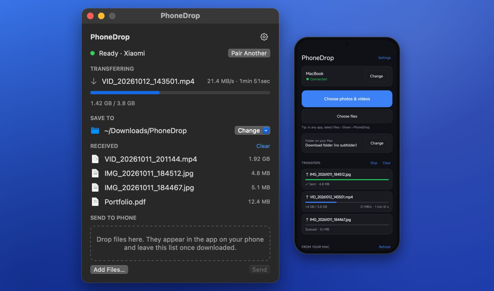
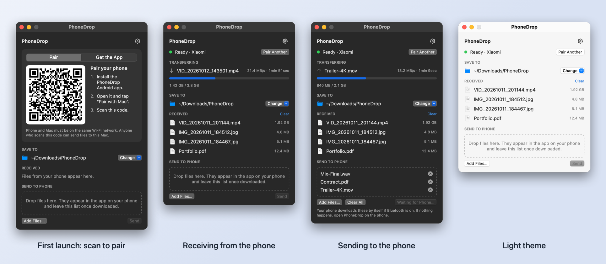
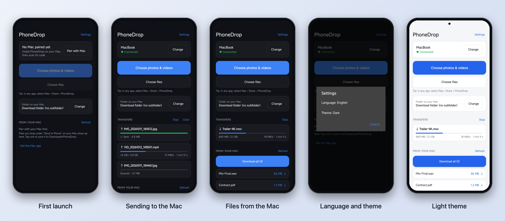
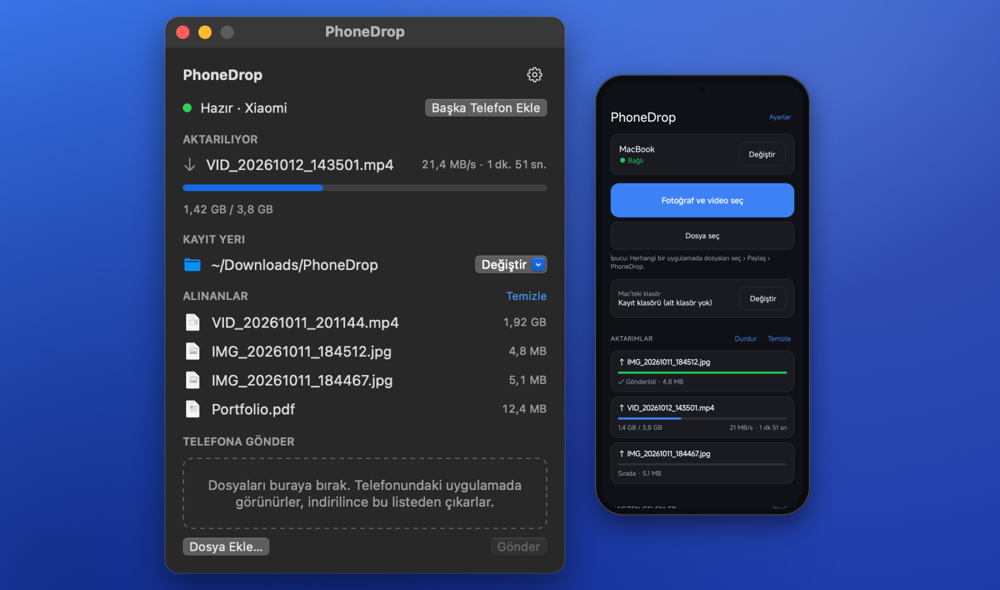
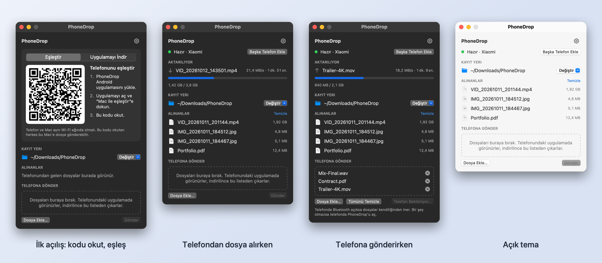
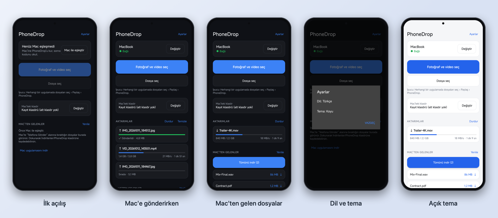

# PhoneDrop

**English** · [Türkçe](#türkçe)

AirDrop-style file transfer between an Android phone and a Mac. Photos, videos, documents or any other
file go straight from one device to the other over your own network: no cables, no cloud, no account.

**[Download](https://osbendes.github.io/phonedrop/)** · Mac app (macOS 13+) and Android app (Android 10+)



## Features

- **Any file, any size.** Transfers run over several connections in parallel at full Wi-Fi speed.
- **Hard to interrupt.** If the connection drops, a transfer resumes where it left off, and it keeps
  running with the phone's screen off.
- **Private.** Every transfer is encrypted with AES-256-GCM. The key is shared once, by scanning a
  QR code on the Mac. Nothing leaves your network.
- **Phone to Mac.** Share from any Android app (Share › PhoneDrop), or pick files in the app. You can
  choose a subfolder on the Mac for each batch.
- **Mac to phone.** Drop files on the PhoneDrop window, or use Finder's right-click › Services or
  Open With. Press **Send** and the phone downloads them by itself.
- **Works without a router.** If the two devices share no network, the phone finds the Mac over
  Bluetooth and connects to it directly. Files still travel over Wi-Fi.
- **English and Turkish, light and dark.** Both follow the system, or pick them yourself in Settings.

## Screenshots

**Mac**



**Android**



The pictures use sample content. They are made by `tools/screenshots.sh` and `tools/make_promo.swift`.

## How it's built

| Folder | What it is |
|---|---|
| `android/` | Android app in Kotlin, with no UI libraries. Share target, foreground transfer service, QR pairing. |
| `mac/` | macOS app in Swift and SwiftUI, with no dependencies. HTTP server, Bonjour, Bluetooth LE. |
| `docs/PROTOCOL.md` | The wire protocol: pairing, encryption, uploads, downloads and direct mode. |
| `docs/` | The download page, the privacy policy and store texts. |
| `tools/` | Scripts that draw the icon and the store graphics. |

Comments on types and important functions are written in English and Turkish (lines marked `TR:`).

## Build

**Mac app** (macOS 13+; the Command Line Tools are enough, Xcode isn't needed):

```bash
mac/build.sh
```

This produces `mac/dist/PhoneDrop.app` (universal, ad-hoc signed) and `mac/dist/PhoneDrop.dmg`.

**Android app:**

```bash
cd android
./gradlew assembleRelease     # APK: app/build/outputs/apk/release/app-release.apk
./gradlew bundleRelease       # Play Store bundle
```

Release builds are signed with the key described in `android/keystore.properties`
(`storeFile`, `storePassword`, `keyAlias`, `keyPassword`). Without that file they use the debug key.

## Tests

`android/app/src/test/.../MacIntegrationTest.kt` runs the Kotlin client against a running Mac app, so
the two implementations of the protocol check each other. Start `PhoneDrop.app`, then create
`/tmp/phonedrop-test.json`:

```json
{"base": "http://127.0.0.1:8765", "saveDir": "<download folder>",
 "outboxId": "<id>", "outboxPath": "<file in outbox>", "outboxId2": "<id>", "outboxPath2": "<another file>"}
```

Then run `./gradlew testDebugUnitTest`. The 1 GiB load test only runs when `/tmp/phonedrop-load` exists.

## Installing the Mac app

The Mac app isn't notarized, so macOS blocks it the first time. To open it:

1. Open System Settings › Privacy & Security.
2. Next to the message about PhoneDrop, click **Open Anyway**.
3. Allow access to the Downloads folder, Bluetooth and the local network when macOS asks.

## License

PhoneDrop is released under the [MIT License](LICENSE).

Third-party components:

- [ZXing](https://github.com/zxing/zxing) core (Apache License 2.0): draws the QR code in the Android app.
- Google Play services code scanner (ML Kit): scans the pairing QR code on Android. It is covered by Google's terms.

---

## Türkçe

[English](#phonedrop) · **Türkçe**

Android telefon ile Mac arasında AirDrop tarzı dosya aktarımı. Fotoğraf, video, belge ya da başka her
tür dosya, kendi ağın üzerinden bir cihazdan diğerine doğrudan gider: kablo, bulut ya da hesap gerekmez.

**[İndir](https://osbendes.github.io/phonedrop/)** · Mac uygulaması (macOS 13+) ve Android uygulaması (Android 10+)



### Özellikler

- **Her tür ve her boyutta dosya.** Aktarım, birden fazla paralel bağlantıyla Wi-Fi'ın tam hızında yapılır.
- **Kesintiye dayanıklı.** Bağlantı koparsa aktarım kaldığı yerden devam eder, telefonun ekranı
  kapalıyken de sürer.
- **Gizli.** Her aktarım AES-256-GCM ile şifrelenir. Anahtar, Mac'teki karekod okutularak bir kez
  paylaşılır. Hiçbir şey ağının dışına çıkmaz.
- **Telefondan Mac'e.** Herhangi bir Android uygulamasından paylaş (Paylaş › PhoneDrop) ya da dosyaları
  uygulamadan seç. Her gönderim için Mac'te bir alt klasör seçebilirsin.
- **Mac'ten telefona.** Dosyaları PhoneDrop penceresine bırak ya da Finder'da sağ tık › Hizmetler veya
  Birlikte Aç'ı kullan. **Gönder**'e bastığında telefon dosyaları kendiliğinden indirir.
- **Modem olmadan da çalışır.** İki cihazın ortak bir ağı yoksa telefon Mac'i Bluetooth ile bulur ve
  ona doğrudan bağlanır. Dosyalar yine Wi-Fi üzerinden gider.
- **Türkçe ve İngilizce, açık ve koyu tema.** İkisi de sistemi izler; istersen Ayarlar'dan kendin seçersin.

### Ekran görüntüleri

**Mac**



**Android**



Görsellerde örnek içerik kullanılır. `tools/screenshots.sh` ve `tools/make_promo.swift` ile üretilirler.

### Yapısı

| Klasör | İçeriği |
|---|---|
| `android/` | Kotlin ile yazılmış Android uygulaması; arayüz kütüphanesi kullanmaz. Paylaşım hedefi, ön plan aktarım servisi, karekodla eşleştirme. |
| `mac/` | Swift ve SwiftUI ile yazılmış macOS uygulaması; bağımlılığı yoktur. HTTP sunucusu, Bonjour, Bluetooth LE. |
| `docs/PROTOCOL.md` | İletişim protokolü: eşleştirme, şifreleme, yükleme, indirme ve doğrudan mod. |
| `docs/` | İndirme sayfası, gizlilik politikası ve mağaza metinleri. |
| `tools/` | İkonu ve mağaza görsellerini çizen betikler. |

Türlerin ve önemli fonksiyonların açıklamaları İngilizce ve Türkçe yazılmıştır (`TR:` ile başlayan satırlar).

### Derleme

**Mac uygulaması** (macOS 13+; Command Line Tools yeterlidir, Xcode gerekmez):

```bash
mac/build.sh
```

Bu komut `mac/dist/PhoneDrop.app` (universal, ad-hoc imzalı) ve `mac/dist/PhoneDrop.dmg` dosyalarını üretir.

**Android uygulaması:**

```bash
cd android
./gradlew assembleRelease     # APK: app/build/outputs/apk/release/app-release.apk
./gradlew bundleRelease       # Play Store paketi
```

Yayın derlemeleri `android/keystore.properties` dosyasında tanımlı anahtarla imzalanır
(`storeFile`, `storePassword`, `keyAlias`, `keyPassword`). Bu dosya yoksa debug anahtarı kullanılır.

### Testler

`android/app/src/test/.../MacIntegrationTest.kt`, Kotlin istemcisini çalışan bir Mac uygulamasına karşı
çalıştırır; böylece protokolün iki ayrı uygulaması birbirini sınar. `PhoneDrop.app`'i başlat, sonra
yukarıdaki biçimde `/tmp/phonedrop-test.json` dosyasını oluştur ve `./gradlew testDebugUnitTest` çalıştır.
1 GiB'lık yük testi yalnızca `/tmp/phonedrop-load` dosyası varsa çalışır.

### Mac uygulamasını kurma

Mac uygulaması Apple tarafından onaylanmış (notarized) değildir, bu yüzden macOS ilk açılışta engeller.
Açmak için:

1. Sistem Ayarları › Gizlilik ve Güvenlik'i aç.
2. PhoneDrop ile ilgili mesajın yanındaki **Yine de Aç**'a tıkla.
3. macOS sorduğunda İndirilenler klasörüne, Bluetooth'a ve yerel ağa erişime izin ver.

### Lisans

PhoneDrop, [MIT Lisansı](LICENSE) ile yayınlanmıştır. Kullanılan üçüncü taraf bileşenler yukarıda,
İngilizce bölümde listelenmiştir.
